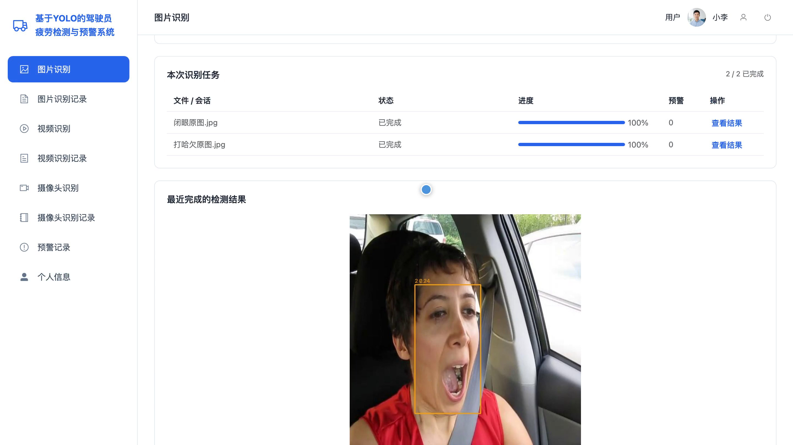
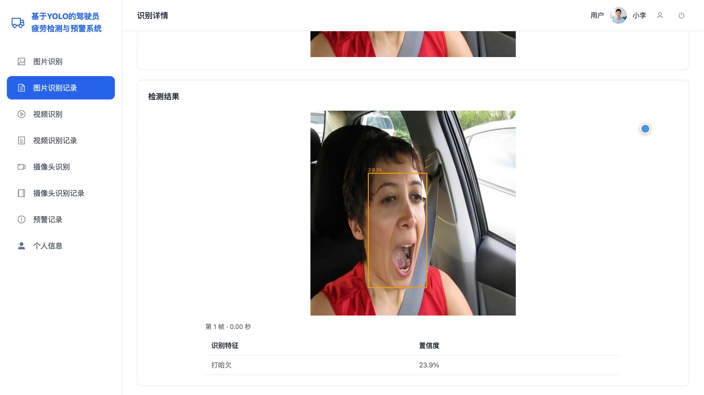
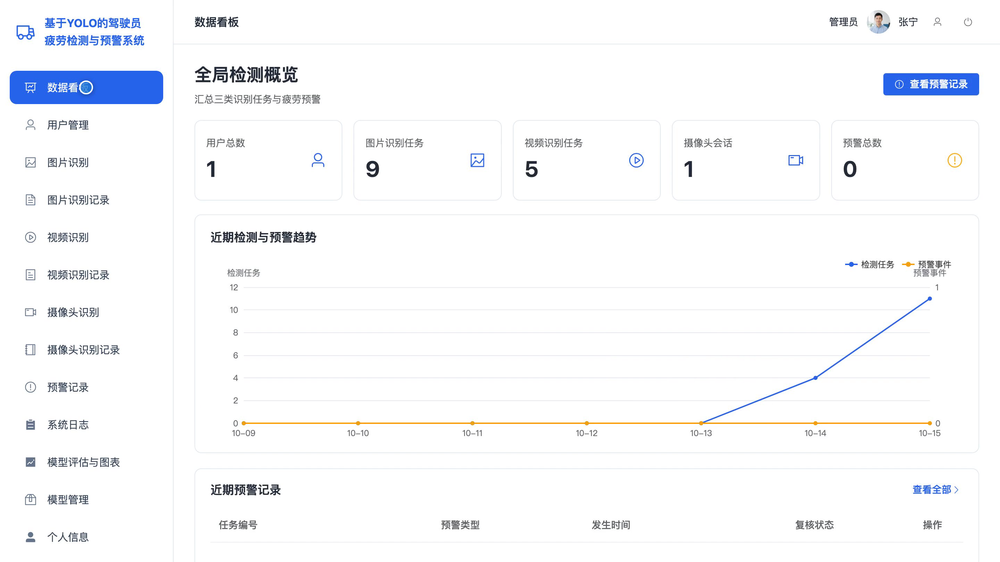
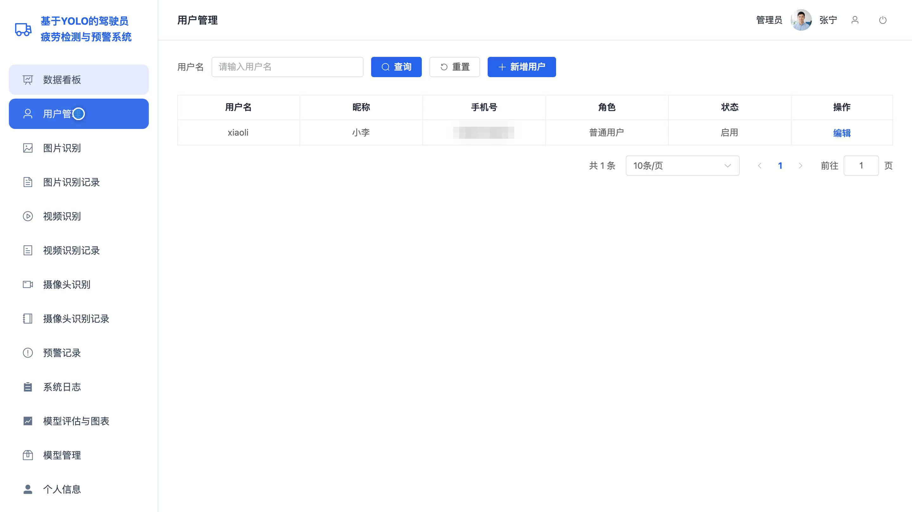
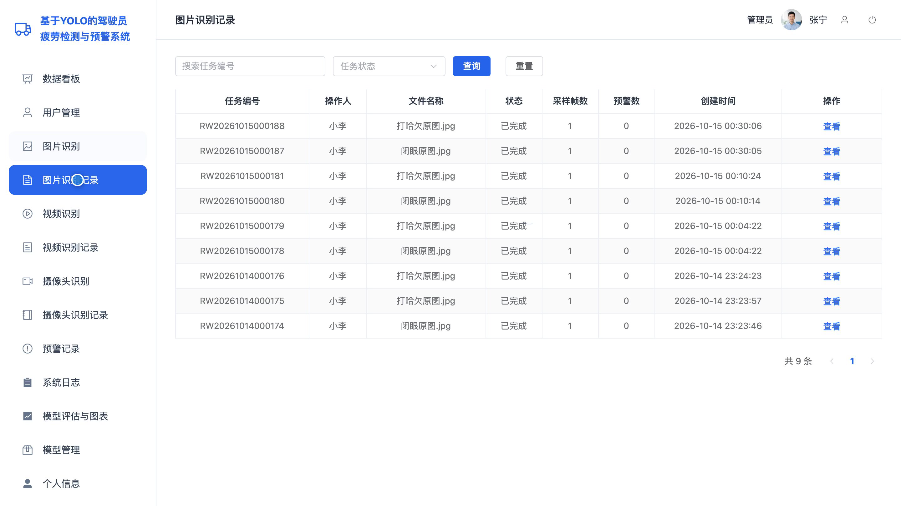
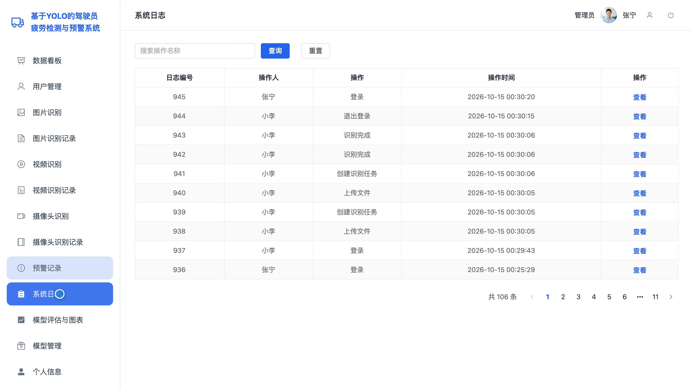
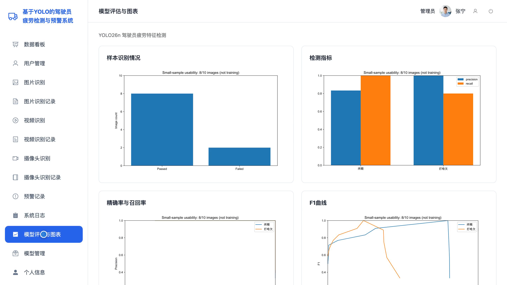

# bs167D
bs167D基于YOLO 的驾驶员疲劳检测与预警系统源码 Python Django Vue3
## 源码问题查看主页咨询

### 一、关键词
驾驶员疲劳检测、疲劳驾驶预警、闭眼监测、打哈欠识别、行车安全监控

### 二、作品包含
源码+数据库+全套环境和工具资源+本地部署教程

### 三、项目技术
前端技术： Html、Css、Js、Vue3.4、Element-Plus
后端技术：Python、Django、DRF、Ultralytics、PyTorch、OpenCV、YOLO26n

### 四、运行环境要求
开发工具：PyCharm + VSCODE

数据库：MySQL5.7+（共9张表）

数据库管理工具：Navicat10以上版本

环境配置软件： Python3.11

前端Nodejs：16+

浏览器：谷歌浏览器

### 五、项目介绍
项目编号：bs167D

本系统面向驾驶员疲劳状态检测，支持通过图片识别闭眼与打哈欠特征，通过视频和摄像头持续检测并按时间阈值形成预警。用户可查看本人检测任务及预警记录，管理员可查看全局统计并维护用户、检测记录和已验证模型。

角色：用户、管理员

用户功能：图片单张及批量识别、视频及摄像头持续识别、闭眼及打哈欠时序预警、本人图片及视频与摄像头记录查询、预警详情及关联检测结果查看、个人资料与密码维护。

管理员功能：全局检测数据看板、用户及账号状态管理、图片及视频与摄像头识别、全局识别记录与预警记录管理、系统日志查询、模型评估图表查看与放大、模型登记与已验证版本切换、个人资料与密码维护。

### 六、运行截图

